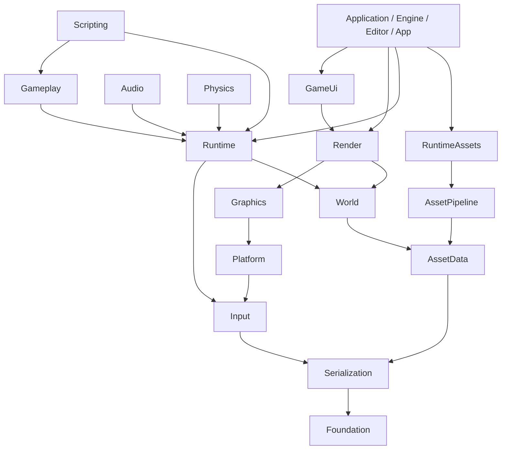
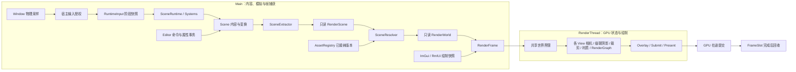

# 引擎架构与运行时边界

本文描述当前模块、所有权和关键时序。功能规划与验收见[路线图](../engine-roadmap.md)，构建入口见 [README](../../README.md)，具体操作见[使用手册](../usage.md)。

## 构建模块

项目使用 `build/`、`build-editor/`、`build-release/` 三个构建目录，对外提供一个 `engine` 动态库和 `Comet::Engine` 目标。
内部对象库约束依赖与增量编译，全部汇入 engine；App、Editor 和资产准备工具直接链接 engine。
源码归属由 `engine/cmake/module_sources.cmake` 声明，依赖由 `modules.cmake` 声明。目录组织按功能，编译模块按依赖边界组织。

| 模块 | 职责 | 主要依赖 |
| --- | --- | --- |
| Foundation | 错误、文件、UUID、参数值、数学、任务、项目路径、日志和 CPU 计时 | GLM、spdlog、Threads |
| Serialization | JSON 编解码、字段错误定位与文件流程 | Foundation、simdjson |
| ShaderContracts | 后端无关 Shader 契约与 SPIR-V 反射 | Foundation、SPIRV-Reflect |
| AssetData | Handle、Registry、CPU 产品数据、脚本定义和资产字段序列化 | Serialization、ShaderContracts |
| Input | 采样值、动作、输入组、运行域求值、改键草稿和覆盖 | Serialization |
| World | 实体、组件、描述符、层级、呈现变换、场景内容保存与复制 | AssetData、EnTT |
| Runtime | 时间、暂停／单步、会话、System 生命周期与通用动画实例推进 | World、Input |
| Audio | AudioService、Voice、播放设备与 AudioSystem | Runtime、miniaudio |
| Physics | PhysicsService、刚体世界与 PhysicsSystem | Runtime、Jolt |
| Gameplay | 可复用角色／相机控制、角色动画参数与导航，借用输入快照和 PhysicsAccess | Runtime、Recast／Detour |
| Scripting | 行为 VM、Lua 校验与 ScriptSystem，以及 Gameplay 桥接 | Runtime、Gameplay、Lua |
| AssetPipeline | 扫描、索引、源导入、Artifact 与任务队列 | AssetData、stb_image、fastgltf |
| RuntimeAssets | 需求、加载、失效、版本编排和资源发布契约 | AssetPipeline、Audio／Script 定义 |
| Platform | Window、GLFW 事件、输入采样与剪贴板 | Input、GLFW |
| Graphics | Vulkan／VMA、设备、资源、命令、同步与 Surface | ShaderContracts、Platform |
| Render | 帧、呈现、场景提取、渲染与资产 GPU 候选创建 | Graphics、World、Platform |
| GameUi | RmlUi 会话、输入／GPU 适配和项目控制器 | Render、Platform、RmlUi、Lua |

Project、Profile、玩家设置聚合、Application 与 Engine 是组合层。WindowSettings、VulkanSettings、RenderSettings、AudioSettings 等值类型仍归所属功能模块。
模块接收自身所需参数，不接收完整 Config。Shader 编译工具是生成 Shader 所需的独立进程，复用 Foundation，不反向链接 engine。

## 模块依赖方向

下图箭头表示依赖；组合层可以装配各模块，模块不反向访问宿主。

- World 和 Runtime 不包含窗口、渲染或具体服务后端。System 从 Scene 取得参数，通过明确服务同步，后端不访问 Scene。
- AssetData 不依赖导入或运行实例。RuntimeAssets 不包含渲染对象定义；`asset/runtime/render_asset_factory.h` 声明候选创建契约，Render 提供实现。主线程直接注册不透明资源，Registry 的类型检查不要求完整 GPU 类型。
- Render 消费提取数据和资源服务，不读取项目文件或访问 AssetManager；Graphics 不反向依赖 Render。
- Jolt、miniaudio、Lua、GLFW 等头只进入所属后端或适配实现。Engine 不包含 Editor／ImGui。
- Editor 分为无 ImGui 的 `editor_core`、呈现适配 `editor_imgui` 和功能界面 `editor_ui`。Engine 由宿主组合，功能代码显式借用所属模块的工作流和帧快照。
- Renderer 公共头前置声明帧调度、呈现和 Overlay 类型；需要调用这些类型的集成代码显式包含相应头文件。

CTest 检查直接及传递 include，并在临时副本中验证反向依赖会被拒绝。日志、组件描述符、Registry 和第三方全局状态保留唯一所有权。

## Owner 结构

| Owner | 拥有 | 借用／交付 |
| --- | --- | --- |
| Engine | Window、Scene、Registry、TaskScheduler、Renderer、RenderThread、Runtime、音频与物理服务 | Main 调用宿主钩子；交付一帧并取回绘制结果 |
| Scene | 场景内容、实体身份、真实世界变换与临时呈现变换 | Runtime 推进固定步；提取器读取呈现姿态 |
| SceneRuntime | RuntimeSession 和 System 实例 | 借用当前 Scene 与 RuntimeServices，停止后结束借用 |
| System | 脚本实例或实体／组件绑定 | 借用资产定义和服务；同步配置，回写输出 |
| AssetManager | 加载、导入任务、失效和发布编排 | 借用索引与 Registry，移交 CPU 产品创建 GPU 候选，复核后注册版本 |
| Renderer | 图形上下文、资源服务、帧调度、呈现和场景渲染状态 | 交付离屏帧／诊断快照；在途 slot 保活所用版本 |
| EditorAssets | 编辑器项目索引、源文件操作、资产管理和引用维护 | Worker 交付候选；主线程复核并提交 |
| EditorSceneSession／SceneDocument | 保留的 Edit 内容、Play 切换、文档路径和保存点 | 通过 Engine 激活场景；命令历史只编辑 Edit 内容 |
| 宿主玩家设置／ProjectUi | 玩家选择实例、页面和独立 UI 控制器 | 宿主注入读取、保存、应用及确认服务 |

后台 CPU Worker 导入／解码／编译并交付自有结果；同步 AssetLoader 仍可在 Main 读取产品及准备 CPU 数据。
Main 接纳索引和任务结果，RenderThread 创建 GPU 候选并返回，Main 复核后注册到 Registry。渲染域的程序与 Pipeline 发布由 RenderThread 管理；文件监听只提示复核，不直接修改世界或资源。
候选携带实际输入和版本身份，过期结果拒绝发布；连续保存沿既有任务背压和最新请求合并流程处理。
源文件操作属于 `editor/assets`，运行时加载属于 AssetManager；两者共享索引，分别负责自己的工作流。

## 应用启动与失败清理

`app/main.cpp` 与 `editor/main.cpp` 显式提供配置路径和 Profile，调用同一个 `Comet::launch`。
launch 只处理可选项目路径、`--help`、错误输出和退出码；帮助／参数错误不加载配置或创建窗口。
App 的 `run_game` 选择开发项目或导出包，加载 Profile 与玩家设置后运行一个 GameApp。
Editor 的 `run_editor` 加载项目、Profile 与本地窗口状态；切换项目时完整结束并销毁旧会话，再创建下一次会话。
`Application::run(Config)` 统一管理 Engine 生命周期和宿主钩子，游戏显示设置在 Editor 中只用于项目视口。
Engine／Renderer／设备等工厂先准备完整 owner，成功后交付；部分准备失败随局部对象清理，不发布空句柄成功对象。
`on_init` 开始后，预期错误沿 Result 返回，关闭顺序为 Engine 停止准备、宿主清理、Engine 销毁、Diagnostics 释放。
宿主关闭钩子只执行一次，并能清理部分初始化。未预期宿主异常不由 run／launch 捕获；第三方解析异常在对应适配层转换，渲染线程异常在帧交接处转为错误回传。
项目描述损坏时启动失败；Editor 的启动场景损坏可报告后打开空场景，供修复，不覆盖源文件。

## 一帧经过哪里

1. Main 处理窗口事件，再等待上一帧 RenderThread 完成；绘制错误原样返回。宿主 `on_update` 消费上次 UI 请求、维护资产与切换模式。最小化／零尺寸仍接纳有界后台结果，但 delta_time 为零、输入为空，不进入模拟与绘制，Main 刷新资产引用并由 GPU owner 执行失效与退役回收；恢复时不追赶挂起时间。
2. Main 捕获窗口尺寸，RenderThread 准备 slot／交换链、回收资源并重建 GPU dependent；帧就绪时调用 `on_frame_ready`，收集 ImGui 请求、属性编辑、Gizmo 和输入授权。
3. `on_runtime_input` 交付只读授权快照；暂停单步先推进模拟，Main 在 `on_frame_capture` 生成依赖当前姿态的反馈，再由 SceneExtractor 提取场景。SceneResolver 固定资源、材质值和选定 Shader 引用；路径追踪从这一份 RenderWorld 准备 CPU 快照，Editor 只提交模式／参数与显示诊断。组合视图、拾取、调试线段及 UI 绘制数据后交付只读 RenderFrame。交接最多保留一帧，包括已经开始录制的帧。
4. 持续运行时，Main 的 Runtime 执行有界 Fixed Update 和一次普通 Update，与 RenderThread 绘制刚交付的快照重叠，模拟结果在下一帧提取。暂停单步则在本次提取前完成，编辑和单步结果直接显示在本帧。提取仍等上一份绘制完成，复用已有快照存储。更新失败先取回绘制结果，再交给宿主恢复，不提取部分写入的场景。
5. RenderThread 准备世界界限；各 View 根据自己的相机生成级联阴影、裁剪、绘制和后处理，再绘制 Overlay、提交并呈现。Main 在取回结果前不修改 Renderer、View 或 UI 后端。退出主循环前取回最后一帧结果并接回资源回收，宿主关闭前由 RenderThread 等待 GPU 空闲、关闭 UI GPU 后端，再停止并 join；窗口输入与文档由 Main 关闭。

持续运行时，Main 交付帧 N 后推进下一步模拟，与该帧绘制重叠；下一次提取前等绘制结果。
编辑／暂停单步先修改 Scene 再提取。RenderSubmission 只在持有 RenderWorld 时临时借用，不单独跨线程排队。
macOS 渲染线程使用交互 QoS；线程优先级不保证固定 CPU 核心，收益以相同负载的墙钟和尾延迟测量为准。

Main 的计时区分事件、等待渲染线程、更新、帧准备／UI 和帧交付。RenderDiagnostics 在绘制所属线程直接计量成功帧，覆盖世界准备、所有 View、UI、提交与呈现；单视图图计时继续独立。不同线程的墙钟阶段不能直接相加。

| 数据／状态 | Owner | 消费约束 |
| --- | --- | --- |
| 场景内容、变换与变化记录 | Scene | 受控写入记录变化；提取器和物理系统读取批次，成功后由 Scene 清理 |
| CPU 快照与实体槽位 | SceneExtractor；消费者持有只读快照 | 快照不借用组件，可独立保留；提取器独占写入及自己的索引 |
| 解析后的世界与资源引用 | Engine 的 SceneResolver 生产；RenderFrame 持有，Renderer 在录制期间借用 | 录制结束先解除几何借用，再在 RenderThread 释放帧引用；Main 取回完成结果后可独占复用，有外部旧读者时复制后更新 |
| 世界界限和本帧几何列表 | Renderer／RenderGeometry | 缓存界限值；列表借用世界和缓存，clear_frame 结束借用，reset 同时清空缓存 |
| 光照参数与阴影 | 各 SceneRenderer 的 ShadowPass | 每个 View 按自己的相机生成四级方向光投影，选择最多四盏聚光灯与两盏六面点光源；各帧槽持有独立的固定尺寸图集 |
| 相机诊断与目标 | Renderer 的 ViewState／SceneRenderer | 每个 View 独立；帧包固定当时的视图参数、拾取与调试线，隐藏保留目标并消费临时请求 |
| 可见列表、材质帧资源和绘制队列 | SceneRenderer／MaterialRenderer | 同步消费 RenderSubmission；实际使用的 GPU 版本由 FrameSlot 保活 |
| 资产注销与缓存淘汰 | Main 取走 Registry 删除批次；各 GPU 缓存消费同一批次 | 批次只保存注销身份或全量重置，不借用注册表；隐藏 View 也清理，旧反馈与在途帧继续保活 |
| 编辑器 UI 绘制帧 | Main 构建；ImGui 后端消费一次 | 顶点、索引、命令、回调内联数据、字体像素与视口图片引用独立持有；GPU 版本由 FrameSlot 保活，交换链重建丢弃旧尺寸的 UI 帧 |
| ImGui 上下文 | 前端持有输入／布局／字体；独立后端持有 Vulkan 状态／录制视口 | 原生后端不访问前端上下文；GPU 重建保留 GLFW 和待处理输入；当前上下文选择为线程局部状态 |

App 与 Editor 都只使用默认 View。Editor 的单视口在 Edit 使用编辑相机，在 Play 使用运行副本的主相机；Stop 恢复编辑内容和观察状态。
创建／移除 View 在帧边界完成，场景切换不交换目标；画质重建与热发布不能释放在途帧的旧资源。

增量更新共用槽位与结构编辑规则，保留各阶段的独立消费状态：Scene 内容变化、物理脏集合、资产发布版本不能相互替代。
`common/version` 共享身份／版本标记和序号算法，`common/snapshot` 共享生产者写时复制；更新、清理与发布时机归各 owner。
连续批次可局部更新；漏过批次、换生产者、压缩或缺少变化提示时完整核对。相机、Light 和场景设置仍完整提取。
提取器和解析器独占快照时复用存储，有旧读者时复制后写入；reset／换场景不改旧快照。Registry 总版本只触发相关资源版本核对，材质参数按唯一身份检查后更新受影响物体。
组件通过受控入口提交修改，同值／拒绝写入不推进版本。物理姿态回写只更新变换与渲染，不作为下一步物理配置输入；运行覆盖随改绑、组件移除或 Runtime 停止清理。

GPU 不查询最新 Registry、组件或 UI DOM。Main 捕获固定资源版本、材质值、Shader、视图参数及绘制数据，RenderThread 只消费这次输入；各 View 顺序读取同一世界。
帧延期跳过 UI／提取／绘制但 Runtime 继续，最小化重置墙钟增量和待处理输入。拾取以值返回，Main 在下一次更新核对模式、场景寿命与实体，再修改选择。

ImGui 前端在 `end_frame` 交付自有顶点、索引、命令、回调内联数据、字体像素及视口图片引用；GPU 后端消费一次并按帧槽保活实际绑定。
未变图集共享像素、未变图片复用绑定；新字形或换图创建新 GPU 版本，旧帧不受影响。回调及数据内的引用仍须满足 GPU 录制寿命。
前端与 Vulkan 后端使用独立上下文，当前上下文选择是线程局部的；后端不访问前端 renderer／viewport 状态。
Main 当前仍等绘制完成才构建下一份 UI 或替换 Overlay／文档 owner；后端重建保留窗口输入与布局，丢弃旧尺寸绘制帧。
运行期间的 GPU 重建和关闭清理由 RenderThread 执行，完整关闭先释放绑定，再销毁后端、前端及借用资源；ImGui 初始后端在主循环前创建。

### 输入主链与配置边界

Window 采样键鼠和标准手柄；Input 保存只读物理快照，RuntimeInput 按授权和阶段求值动作。
Fixed Update 累积边沿，重复阶段不重复消费；失焦、连接变化和授权恢复只建立基线，不伪造按下。
App 依据最终 UI 状态授权，Editor 依据视口焦点／悬停授权；输入屏蔽不等同于暂停模拟。

| 设置来源 | 保存位置 | 负责内容 |
| --- | --- | --- |
| C++ 默认值 | 所属模块的设置结构 | 完整、可运行的基础默认值 |
| 开发者 Profile | 根目录 `config.json` 的对应分组 | 诊断、底层格式／交换链／在途帧参数、资源预算；启动只选择一个分组，缺省值来自 C++ |
| 项目默认值 | `project.json` | 游戏显示、画质、音量、输入和 UI 入口 |
| 玩家选择 | 按项目 UUID 隔离的用户目录 | display／quality／audio 完整设置与输入稀疏覆盖 |
| 编辑器本地状态 | 用户／项目本地状态目录 | 窗口、布局、快捷键、最近项目和会话 |

Profile 拒绝玩家设置及未知字段。窗口尺寸与最大化状态由宿主持久化；Window 只维护原生窗口与还原尺寸。
`config/player_settings` 用一份 `PlayerSettings<T>` 实现显示、画质和音量的文件检查、版本／项目身份校验、原子保存和保存后应用。
别名保留各功能名称，具体类型的字段读取／写入／校验仍归 DisplaySettings、QualitySettings、AudioSettings。
输入文件是按动作／绑定身份合并的覆盖，保留 PlayerInputSettings 的独立协议，不套用完整值存储。
`PlayerSettingsOwner` 持有上述四种玩家设置，统一项目默认值、加载、保存、诊断和 Runtime 重绑定；通过 Engine 直接应用设置；Play 只适配离屏分辨率和运行状态。输入仍保存稀疏覆盖，其他设置仍保存完整值。
App 的显示试用由 DisplaySettingsPreview 保存前态和 15 秒期限；确认成功才持久化，取消／超时恢复前态。Editor Play 只应用视口相关设置，不修改编辑器窗口、VSync、HDR 输出或帧率。保存成功但应用失败仍明确报告，不能当作未保存。
项目显示默认值修改后，Editor 重新解析玩家设置并更新 Play 分辨率；已有个人选择仍优先，项目默认值不覆盖玩家文件。

### 序列化与复用边界

| 位置 | 共享能力 | 调用方负责 |
| --- | --- | --- |
| `common/file_io` | 文本读取、有大小上限的二进制读取、原子文本／二进制分块写入 | 文件是否可缺失、预算和业务提交顺序 |
| `common/binary` | 小端整数／浮点数、带长度的字符串读写、分块 FNV-1a 哈希 | Magic、版本、长度前缀宽度、字段限制与领域校验 |
| `common/serialization/parameters_json` | 参数名称、容量、重复键、有限数值与向量校验及编解码 | 允许类型、Scene 实体 UUID 回调及存档值范围 |
| `common/json` | simdjson 解析、对象／数组检查、必填与可选标量字段读取、固定长度浮点向量读写、键校验、可选路径查找、可缺失文件读取、原子保存、Writer、编解码与 Serializer 文件入口 | 项目、场景、材质等 Schema 与版本，缺省值、颜色及数值范围的领域校验 |

项目、资产、开发者 Profile 与快捷键共用 JSON 工具。JSON DOM 借用 parser；`Json::deserialize` 的回调必须返回拥有数据的结果。
快捷键冲突、资产身份、范围等属于具体功能，不放入通用 Reader。
Editor 的窗口、最近项目、项目会话与玩家输入／显示／画质／音量设置共用可缺失 JSON 文件的读取入口：缺失返回空值，已有文件的错误正常上报，不改写原文件。
各工作流决定默认值、保存时机与内存提交规则，解码结果拥有数据，错误来源字符串覆盖整个解析寿命。
资产 Serializer 不再拥有通用 JSON 文件工具。场景描述符共用于保存、恢复、编辑与内容复制；内容 clone 直接走内存快照，不通过 JSON 往返。
Mesh、Texture、ShaderProgram、Environment Artifact 与导入指纹共用二进制基础工具；各资产保留独立头部、版本与校验规则。
ImportInputSnapshot 统一校验源文件首项、规范化相对路径及依赖有序唯一；文件数量／大小限制和实际内容复核由各调用方负责。
Environment 按纹理读取，发布时将头部和四份纹理存储分块原子写入，避免再复制一份完整像素 payload。
TextureArtifact 保存导入设置与完整二维 mip 链，ImportService 按源指纹、算法版本和设置复用缓存；预准备工具、加载与重新导入共用该入口。
TextureImporter 的文件与内存入口共用解码、用途设置和 mip 生成，GLB 内嵌图片无需先写临时文件。
纹理产物发布不等于运行资源发布，AssetManager 仍在 GPU 候选完成后复核 revision。开发模式需要源文件复核。
导出项目以根目录 `assets.index.json` 初始化同一 AssetDatabase 的只读模式：稳定身份、运行文件、依赖及纹理采样方式一次读取，不扫描源文件或写 sidecar。
桌面打包由 `tools/export_app.py` 自动增量构建既有 `app-release`，再组合资源导出；构建失败即停止。Editor 仅收集输出路径／关卡，在后台调用同一工具，并在主线程显示阶段与日志。macOS 随包携带动态库、MoltenVK、配置、字体与图标，运行时通过可执行文件位置解析资源；产品日志／缓存写入项目 UUID 对应的用户目录。
AssetLoader 直接读索引中的 Mesh／Texture／Environment／ShaderProgram 产品；模型子资源已展开，场景中的 Prefab 来源基线不进入运行产品。
环境产品继续使用任务队列与 CPU 预算，Lua 模块保持项目内相对路径。导出工具负责内容转换和依赖闭包，宿主打包层负责可执行文件、动态库、引擎字体与图标。

ModelImporter 的 CPU 候选保留 glTF 节点／场景、primitive 材质关联、图片和采样设置，
与单 Mesh 导入共用几何／骨骼解码。静态节点共用几何，不同蒙皮节点分别保存绑定空间；候选中的下标只关联源内容，不能当作持久资产句柄。
模型 .meta 保存子资源 key 与持久句柄，AssetDatabase 按句柄索引子资源，按路径查询仍返回源模型；源与伴随文件变化会同步使子资源失效。
唯一名称在源数组重排后保持身份；无名／重名内容使用源下标区分，不能据此承诺任意重排后的身份稳定。
ModelArtifact 复用 Mesh／Texture 缓存与材质序列化，先按内容版本写完子资源，再发布模型索引；项目预准备能按场景子资源引用重建整个模型。
AssetLoader 按源模型 revision 共用已验证的索引，子网格／材质／纹理从同一代产品加载，节点数据以只读共享对象返回。
网格的 CPU 读取由 `AssetManager::read_mesh_data` 提供，普通网格、模型子网格和内置角色共用 AssetLoader 的读取路径；
返回自有顶点／索引数据，不创建 GPU 资源或向运行时 Registry 发布。渲染在同一读取结果上创建 GPU 网格，碰撞烘焙无需读取显卡缓冲。
AssetManager::prepare_scene 统一入关时的依赖收集、源模型／网格去重导入和加载提交；只读产品跳过源导入，App 只等待资源就绪并激活场景。
该入口用于加载阶段；Editor 的后台导入与逐帧限额恢复继续使用现有队列，不在编辑帧里同步导入模型。
扫描发现模型或伴随文件变化时，注销整组及依赖资源，旧版本只供已捕获的帧保活。
子材质与纹理导入设置由源模型拥有，不能通过普通资产编辑入口覆盖源文件。
源纹理的 filter／wrap 设置随 Texture 保留；主材质与 Alpha Mask 阴影使用同一采样器，未指定时沿用各渲染器默认值。
Editor 按源模型去重排队：Worker 只准备产品，主线程复核源输入和身份后发布 .meta／索引，再接纳子资源。
新 glTF 默认使用完整 Model；已有 Mesh 元数据保留原身份与加载语义。Project 按模型展示子资源，引用选择显示子资源 key；子资源不单独移动、删除或修改源文件。
模型拖放用 Scene 的层级实例化和既有 EntityTreeCommand：保留局部 TRS、共享几何与 primitive 材质引用，一次操作可撤销、重做并保存。
模型源内容经 Prefab::from_model 转为可更新子树，复用同一实例基线、覆盖合并、序列化和撤销链路。
源实体 UUID 由模型资产句柄与稳定节点键确定，primitive 使用节点键与局部序号，根身份不依赖文件名或节点顺序；实例 UUID 仍独立生成。
只有独立 Prefab 支持源写回，Model 实例支持手动更新、恢复覆盖、解除关联；模型文件继续由外部建模工具编辑。

Prefab 属于 World 内容层：EntityTrees 共用单树／多树捕获、恢复及引用重映射，Editor 的复制、撤销和资产放置复用它。
属性层统一遍历普通 EntityUuid 与参数表内的实体引用，子树复制、内部引用校验和 Prefab 更新冲突检查共用此规则；资产句柄不参与实体重映射。
多树捕获归一化重叠选择；批量放置先在候选场景中完成各份引用映射，再以一条结构命令安装，失败不改目标场景。
Editor 选择服务保存实体 UUID 与主目标次序，不持有跨撤销的运行时 EntityId；面板请求捕获选择集合，执行时不再猜测当前选择。
EditorAssets 拥有 AssetThumbnails：128px 预览、单任务与 32 张缓存限定工作量，项目面板只请求可见资源。
纹理后台任务只读路径与资产记录快照；模型／网格／材质由 Editor 的 ThumbnailRenderer 捕获资源快照和固定取景，Engine 的 ScenePreview 在 GPU owner 上复用 SceneRenderer 与蒙皮通道，异步提交后轮询读回。
每次预览借用同一资产数据库，但使用临时 AssetRegistry／AssetManager 加载，捕获后由世界快照保活；浏览资源不会把它们长期注册到游戏 Registry。
离屏目标、基础 Pipeline 与材质球复用；每次完成释放上次内容的材质、蒙皮与世界引用，只保留缩略像素。ReadbackBuffer 统一处理 VMA 映射与非 coherent 内存失效。
纹理按自身／源版本失效；三维预览在数据库变化或资产发布时失效，以包含贴图、材质和 Shader 依赖变化。过期任务完成后丢弃结果。
ImGuiContext 捕获不可变像素，RenderThread 上传并由 GPU 帧保活，面板销毁不释放在途图片。预览不创建游戏实体、不占主视口，也不参与 Play 更新。
PropertyEditTransaction 支持多目标属性预览与单条撤销，任何属性拒绝写入时恢复该轮预览前值；取消恢复所有仍存活的目标。
Inspector 通过同一组件描述符筛选共同属性，向量逐轴合并、脚本参数逐键合并；Play 使用相同批量写入校验但不记录历史。
资源选择请求携带捕获的目标集合，SceneEditor 一次加载后提交整组引用；更换脚本同时清空对应参数，撤销恢复各自配置与新的组件寿命。
整组手柄仅对归一化后的选中根应用世界变换，使用同一属性事务；旋转／缩放先验证每个本地矩阵能由 TRS 重建，拒绝静默丢弃斜切。
Prefab 通过 SceneSerializer 的实体格式保存内容，不携带关卡环境或运行态；实例根的来源元数据独立于可编辑 Gameplay 组件。
关联保存源资产及类型、不可变内容基线和源 UUID 到实例 UUID 的对应表；场景序列化、Play clone、复制和撤销均保持这份关系。
源更新在独立候选场景中按属性比较基线／本地／新源，脚本参数逐键合并；源新增节点获得新身份，已有节点保持实例 UUID。
实例放置变换不随源变化；会删除本地内容或破坏实体引用的更新作为冲突拒绝。Editor 验证候选后以一条子树替换命令提交，并按 UUID 恢复选择。
写回源内容复用更新候选，再把实例 UUID 映射回源 UUID；新增节点分配源身份，根放置变换仍保留在场景。
Editor 的源写回命令组合资产文件更新与同一子树替换，Undo／Redo 一起恢复文件和实例基线；保存失败补偿文件与场景，不移动历史游标。
后续资产编辑已改变来源时，旧撤销不能覆盖它。恢复覆盖则只替换实例内容，保留放置与已有身份，并拒绝破坏关卡中的外部引用。
Prefab 来源元数据只由编辑更新消费；运行资源依赖包括展开实体，以及 Lua 的显式 Prefab 参数。
ComponentRegistry 通过调用方提供的 Script／Prefab 加载器收集递归依赖，AssetManager 与内容导出共用此遍历；World 不持有资源管理器。
Script 的 Prefab 参数沿用参数表，以字符串保存精确资产身份；Inspector 用资产选择器编辑，不向 Lua 暴露文件加载。
Scene 在阶段末提交拥有 Prefab 与组件描述生命周期的生成请求，复用 EntityTrees 身份重映射；Lua 返回预留根 UUID，提交后可查询。
运行生成不带编辑器来源基线；物理仍要求刚体在根实体，子树中的渲染及脚本实体可以引用这个根。
首版基线随每个实例保存，优先保证保存后仍能区分覆盖；不引入额外缓存数据库、自动合并后台或嵌套 Prefab 系统。

### 系统更新与场景边界

Scene 保存实体身份、组件和层级；结构请求在阶段末提交，遍历中不直接改变结构。RuntimeSession 保存共享值、输入组请求及类型化的重开／切关意图，SceneRuntime 仅在回调执行结束后允许宿主取走请求。
切关请求在消费时复制有界会话值；下一次 start 在 System::on_start 前安装这些值，输入、物理、音频和实体运行态重新开始。
Gameplay 的 GameSession 保存当前关卡的初始内容和入关值，负责生成重开／切关候选，候选成功激活后才接纳新基线。
Editor 借用保留的 Edit 场景作为首关基线，App 接管已加载的初始内容；切关后会话持有新关卡基线，避免把第二关的重开误当返回首关。
CheckpointStore 负责单槽进度 JSON 与原子写入，保存稳定场景身份、检查点名和显式选择的会话值；场景身份查询由宿主注入。
RuntimeSession 只收集保存／继续意图，GameSession 在帧边界调用持久化接口并生成恢复候选；检查点名和进度在 on_start 前安装，出生点与收集规则仍在项目脚本中。App 玩家存档和 Editor Play 存档使用独立路径。
宿主负责项目路径解析、资源准备及活动场景替换。EditorSceneSession 另外保留原 Edit owner，Stop 恢复其身份和历史；App 在候选资产等待期间暂停旧 Runtime，只有就绪后才安装新场景。
父子关系只由 Scene 修改并保持无环；子树删除直接遍历子节点索引，收集完毕后从后代向祖先清理。
Runtime 统一控制系统启停、部分启动失败、暂停和单步；System 不重复实现生命周期状态机。
每个固定步先按注册顺序执行 `fixed_update` 并提交结构请求，再执行 `post_fixed_update` 并提交本阶段的请求；最后才进入每帧 `update`。
全部 System 的 on_start 与启动结构提交结束后，SceneRuntime 调用 on_runtime_ready。NavigationSystem 此时读取已准备物理世界的静态碰撞三角形并同步构建网格；失败沿既有逆序停止路径处理，尚未推进模拟。固定步只重置查询预算和回收角色路径；构建耗时与运行查询分别计数。NavigationMesh 封装 Recast／Detour，公开头文件不暴露第三方类型；NavigationSystem 持有运行域路径缓存，Lua 只提交目标，Demo 决定巡逻／追逐规则。静态碰撞几何来源由 Engine 注入，Gameplay 不依赖 Jolt 或 PhysicsService 实现。Stop 清理网格与缓存，路径不进入场景序列化。

默认固定步依次执行脚本意图、角色动画参数、根运动动画提取与 Gameplay 消费、PhysicsSystem 同步／求解／回写，再更新粒子；接触在该步的后置阶段交付脚本，阶段结束即清空。根运动或脚部 IK 的实例使用固定步，其他动画仍在帧更新中推进，不同时使用两套时钟。
固定更新中删除的实体不再收到接触；接触回调的结构请求在下一固定步前生效。后置阶段复用本步时间和输入，不再次消费边沿。
普通更新执行相机、脚本玩法／自定义事件和声音源同步，不重复交付接触。暂停不执行更新，单步完整执行一次固定、后置和普通阶段。

固定步姿态插值由 Scene 拥有的 TransformInterpolation 保存临时历史；Runtime 只控制固定步边界和插值系数。
只记录固定／后置阶段实际改变的本地姿态，并缓存受影响子树；静止场景继续直接提取真实 WorldTransform，不逐步复制全部 Transform。
SceneExtractor 通过 `Scene::get_render_transform` 为网格、相机和灯光读取同一呈现层级，位置／缩放线性插值、旋转四元数插值；相机／灯光朝向仍排除祖先缩放。
普通更新取消实体自身的固定步历史；显式 Teleport、生成和重挂接清除子树历史，暂停／单步／停止清空全部历史。
真实变换与呈现缓存共用 Scene 的变换版本来源，呈现变化只通知渲染批次；不回写内容、物理或脚本查询，也不改变已交付快照。
固定步运动显示延后一个模拟步。固定步动画也在该边界记录前后局部 TRS，呈现时先插值再生成蒙皮、骨骼挂点与包围盒；不线性混合蒙皮矩阵。真实姿态与呈现姿态分别缓存，骨架／动画库替换后清除历史。Render 只消费只读快照，不依赖 Runtime。

物理后端仅接收借用参数及身份值；系统检查必需组件和父级，后端在新建／变化时校验值域。
启动时登记刚体与角色；运行时只同步脏实体的 Transform、物理配置与父级变化。
Scene 的物理脏集合独立于渲染变更批次，固定步成功同步后清空；相同组件值不入队，销毁时移除脏项。
刚体／角色增删触发登记列表清理，核对实体寿命与组件存在；少量配置修改和稳定步不扫描全部配置。
运动学目标旋转不变时复用四元数，后端维护自己的运动学刚体列表并每步更新速度；列表不借用 Scene 组件。
AudioService 拥有设备和 Voice，PhysicsService 拥有 Jolt 世界、刚体、虚拟角色和关节；System 只保存实体绑定，不让内容组件持有后端对象。
CharacterController 保存胶囊尺寸、移动／跳跃速度、坡度、台阶、地面吸附与重力配置；脚底为原点，只支持竖直、无父级及正等比缩放。它与 RigidBody 不能拥有同一 Transform，外观／跟随相机可作为子实体。
玩法通过 PhysicsAccess 提交世界 XZ 移动意图与跳跃边沿，最近请求只作用于下一固定步；静止也继续重力、地面吸附与平台跟随。PhysicsSystem 沿既有脏批次同步角色；PhysicsService 在运动学速度准备后、Jolt 世界步进前更新 CharacterVirtual，再沿同一姿态回写入口发布位置。胶囊及代理刚体归后端，代理进入已有接触身份索引，使触发通知共用后置固定阶段；销毁和 Stop 释放代理，不把地面状态／速度写入内容。

PointJoint 保存启用、连接实体 UUID 与两个锚点，HingeJoint／SliderJoint 额外保存两端轴、参考方向与可选限位／驱动参数，复用属性描述符的保存、克隆、撤销和实体引用重映射；Inspector 复用脚本参数的实体选择控件。
PhysicsSystem 先完成刚体同步，再提交按实体与关节类型排序的关节定义；仅关节配置、刚体增删或重建触发关节同步，稳定步不扫描场景关节配置。
三种关节共用同步、校验和销毁流程，铰链／滑动共用方向与参考基、弹簧和驱动设置；属性元信息共用限位弹簧与驱动字段，仍保留角度／行程及力矩／力的区别。PhysicsService 按实体与关节类型保存独立配置和两端原生身份，未变的连接复用 Jolt 对象；刚体删除／重建及世界销毁前先移除并释放关联关节。
空 UUID 表示固定世界点；缺失连接停用，不能隐式改为世界连接。盒／球的本地锚点随实体缩放，要求至少一端动态；点关节允许自由转动，铰链只允许绕两端转轴旋转。
铰链限位的零点由内容参考方向投影到转轴垂直平面定义，重建后复用同一基准；PhysicsService 将本端相对连接端的角度／角速度换算为 Jolt 的相反方向，速度驱动受最大力矩和限位约束。
滑动关节以锚点重合为零行程，由两端轴和参考方向定义相对朝向；只允许沿本端当前轴相对平移，双动态连接仍可整体旋转，行程／速度／驱动力分别以米、米每秒、牛顿计。后端同样换算本端相对连接端的符号，重建后保持内容基准。
速度驱动与位置驱动共用已有固定步同步边界；位置驱动使用保存的参考基，即使铰链未开启限位也不重新定义零度。位置目标按启用的限位钳制，采用频率／阻尼比弹簧且受力矩／力上限约束，负载下允许稳态误差；限位频率为 0 时为硬限位，正值启用越界弹簧。
断裂阈值随关节内容保存，默认 0 关闭；点关节只有力阈值，铰链／滑动额外支持力矩。PhysicsService 维护正阈值关节的独立检查列表，Jolt 更新完成后按求解冲量除以固定步长计算载荷；轴向取限位／驱动冲量的较大绝对值，再与锁定方向组合，避免反向冲量抵消断裂判断。休眠约束不读取旧载荷，阈值修改沿现有同步入口唤醒刚体。
断裂检查先收集拥有数据的记录，再统一移除后端约束；PhysicsSystem 在同一固定步通过场景提交入口取消对应运行组件的启用并记录日志。运行场景的 enabled 表达断裂后的停用，刚体重建和其他关节同步保持该状态；手动启用重新绑定，Stop／重开随编辑副本恢复。
Editor 的 PhysicsOverlay 共用现有 LineDrawList，按开关读取碰撞体和关节的呈现变换，在帧捕获前生成独立线段；不访问 Jolt，不修改组件。铰链转轴、零度方向和限位弧使用不含缩放的呈现姿态，位置目标按内容限位钳制后显示绿色标记；Inspector 按驱动模式和限位频率显示参数，对齐使用真实场景变换，共用方向归一化与垂直投影。
滑动轴、朝向和行程导轨沿用同一预览边界，导轨以连接端锚点为零点，长度不随实体缩放。
Inspector 的锚点对齐按真实世界变换与目标逆变换计算连接坐标，仍经同一属性提交入口保存／撤销或修改 Play 副本。
Runtime／脚本借用 PhysicsAccess，统一校验运行域、实体寿命与组件；该接口提供玩法命令和速度查询，不暴露世界步进或 Jolt 对象。
冲量、力和力矩共用一个 128 项队列，在同步配置后按提交顺序执行；力／力矩只作用于一个固定步，连续运动逐固定步提交。
`request_impulse_at`／`request_force_at` 保存世界空间作用点，执行时以同步后的物理质心计算力臂，复用同一请求校验与寿命边界。
PhysicsService 校验力臂、力矩及速度的有限范围后调用 Jolt 的作用点接口，旋转响应由后端质量与惯性决定；Lua 只提交六个有限数值。
执行时复核实体身份及 Dynamic 类型，停止／失败清空队列；查询返回最近模拟状态的值，尚未登记返回空值，Lua 报告调用错误。
RigidBody 保存指定质量／密度两种模式及各自参数，旧场景默认指定质量；PropertyDescriptor 负责保存、克隆与撤销，Inspector 只显示当前模式的输入框。
PhysicsService 使用已缩放的 Jolt Shape 体积计算密度质量，并复用质量／惯性的校验与更新路径；不把计算值回写为内容质量，也不在 Editor 重复物理公式。
后端保存完整刚体配置，CCD 方式从该配置派生；只有当前质量模式使用的参数变化才更新动态质量并唤醒刚体，保留线性／角速度与接触身份。
同一动态实体的缩放或碰撞形状改变会重建后端刚体，保留线性／角速度，按新形状计算质量／惯性并重新绑定关节；新实体和运动类型切换按新的配置创建。
RigidBody 的 `continuous_collision` 保存内容配置，默认关闭；PhysicsService 仅为动态非触发器选择 Jolt LinearCast，其余使用 Discrete。
配置变化在同步边界调用 SetMotionQuality，原地保留刚体身份、速度和休眠状态；运动类型／形状变化仍沿现有重建路径处理。
线性 CCD 不提供旋转扫掠或触发区连续查询，接触通知仍沿现有 Jolt 回调与阶段末派发处理，不以渲染插值判断碰撞。
Collider／CharacterController 保存 32 位所属层和检测掩码，沿 UInt32 属性描述器完成编辑、序列化与撤销；Inspector 以位勾选显示，数值不经过 float。
PhysicsService 将所属层和掩码映射到 Jolt CollisionGroup，并由 GroupFilter 执行双向位匹配。角色形状查询使用相同匹配规则，内部刚体也设置同一碰撞组；改变过滤设置会在固定同步重建并刷新接触。
玩法查询只按 QueryFilter 的层掩码与目标所属层匹配，另支持忽略实体和触发器筛选；物理响应与查询的掩码含义分开定义。
普通 Collider 使用盒／球／胶囊／凸包／静态三角网格形状，胶囊以实体原点为中心，尺寸沿本地 Y 轴；球和胶囊使用正的等比缩放，角色胶囊保持脚底原点语义。
PhysicsAccess 提供世界空间射线、盒／球／胶囊扫掠和球形重叠查询，PhysicsService 负责 Jolt 查询与实体身份映射；命中结果不暴露后端 BodyID。
刚体和扫掠共用形状尺寸校验与 Jolt 形状构造；相机球体扫掠通过同一接口提取移动比例。
查询读取最近同步的物理世界，支持忽略指定实体与包含触发器；Lua 默认忽略自身，重叠结果按 UUID 去重排序。Lua 回传数组由受保护调用外的 Context 持有，内存错误不会跳过容器析构。
网格碰撞由 App／Editor 通过既有默认 System 装配提供 CPU 读取与产品版本；PhysicsService 不依赖 AssetManager、Render 或 GPU Mesh。
网格 CPU 产品的可用性、准备状态与发布版本由 AssetManager 统一维护；扫描失效和导入发布都会通知物理消费者，读取已发布普通网格不回读源文件。
碰撞网格属性标为 CPU-only 资产引用，资产准备／就绪检查／编辑器恢复不会强制创建 GPU 网格；同一网格另有渲染引用时仍按正常路径上传。
Jolt 形状按网格、revision、类型与缩放共用，固定步仅检查网格刚体的产品版本；过期形状重建并重绑关节，失去刚体引用的缓存会释放。
凸包保留源原点与质心偏移，三角网格只接受静态刚体；形状构建错误使运行失败，不以包围盒或旧碰撞替代。网格使用绑定姿态，不由动画逐帧烘焙。

Collider 保存摩擦和弹性系数（0～1），默认 0.2／0；PropertyDescriptor 共用 Inspector、序列化与撤销边界，后端同步也校验 C++ 提交值。
形状／触发器变化沿原有重建路径处理；单改接触系数在固定步原地更新，不唤醒或清除速度、休眠与接触缓存。
接触响应使用 Jolt 的几何平均摩擦和最大弹性组合，活动接触每步重新读取系数；这些配置属于碰撞体，与渲染 Material 分开。
动态姿态只回写实际活动或本步状态变化的刚体，沿同一变换校验入口更新场景／渲染，跳过下一步的物理输入通知。
删除／重建和休眠接触使用有效身份，旧请求不绑定到复用槽位。Jolt 并行尚未实现。

## 粒子模拟与呈现

ParticleEmitterComponent 保存内容配置；ParticleSystem 在固定步维护连续存储的有限粒子池，不为每个粒子创建 Entity。
Lua 爆发请求在 Scene 内保存触发配置和世界姿态，脚本／动画事件完成后交付；已出生粒子可在源实体销毁后自然消退。
Scene 只发布不可变 ParticleSnapshot，按混合方式与纹理分组；提取与资产解析沿现有 RenderScene／RenderWorld 传递，不借用模拟容器。
纹理引用归 Emitter 配置，源实体销毁后的存活粒子仍参与运行时资产需求；SceneResolver 在 Main 解析纹理，RenderWorld 保留该帧资源。
ParticlePass 在 Render 线程上传当前帧槽的实例缓冲，支持加法／Alpha billboard，随后进入后处理；管线、缓冲和不可变纹理绑定沿 FrameSlot 保活。
纯加法且没有透明网格时直接上传快照；存在 Alpha 粒子或透明网格时，在 Render 私有可复用数组按相机深度排序全部粒子，再合并连续同状态实例。相同深度使用原快照次序，不改写 Main 数据。
MaterialRenderer 与 ParticlePass 分开准备资源和录制命令；SceneRenderer 先画不透明物体，再线性归并透明网格与粒子的深度流，按连续同类区间录制。网格可切开粒子批次，切换后重新绑定各自的顶点、管线与描述符；每帧结束清理借用数据。
网格使用包围盒中心，粒子使用中心深度；同深度先网格后粒子。对象级排序不能精确解决相交几何或同一网格内部的透明层叠，OIT 另行扩展。
纹理上传完成信号参与提交等待，替换资源不改写在途描述符。未指定纹理使用柔边圆形，显式引用缺失时诊断并跳过对应批次。
暂停／单步与 Stop／切关复用 Runtime 协议；场景保存、克隆和 Prefab 不携带存活粒子。素材与触发规则继续归项目。
Editor 的 ParticlePreview 只持有单发射器代理 Scene 和 ParticleSystem，以现有 Runtime 推进并发布到 Edit 视口；不启动游戏脚本、物理或音频，不写撤销历史。

## 音频与运行域

音频源／监听者保存场景配置，AudioSystem 从世界变换同步位置与朝向；AudioService 独占运行域的播放实例、分类音量和一次性请求。
脚本与动画事件完成后交付声音；一次性请求携带触发位置快照，持续声源随实体同步。
AudioClip 保存不可变 PCM 或流式文件的格式与来源；流式导入设置随资源 metadata 和导出产品索引传递。
miniaudio 的设备、解码器、页面与任务队列封装在 AudioPlayback 实现中，实时播放使用后台解码，离线混音同步推进解码任务。
暂停保持游标，单步静默推进；Stop／切关释放 Voice 和流式句柄。音量与设备服务属于 Engine，背景音乐、音效素材和触发规则属于项目。

## Lua 脚本与参数

- `asset/script` 保存不可变入口／模块源码、字段默认值和事件声明，不依赖 Entity、Runtime 或 VM。
- `scripting/script_instance` 拥有每实体独立的 VM、定义／self 和模块缓存；ScriptSystem 保存实际运行定义并调度。
- ScriptComponent 保存 Handle 与稀疏参数覆盖；`common/parameters` 共享参数类型和过滤规则，普通参数编辑不重建实例。
- Inspector Edit 查询资产定义，Play 查询实际实例定义。查询核对场景、实体和组件寿命，返回值不延长实例寿命。

源码重载先准备并校验关联资产及候选 VM；同一批源修改只构建一次驻留脚本索引，各组发布后更新成员身份和依赖。准备失败保留旧版，成功后逆序停止旧实例并启动新版。
新版 `on_start` 或运行回调已可能修改世界，执行失败沿 Runtime 停止／Editor 恢复 Edit 路径处理，不承诺回滚副作用。
换版保留兼容参数覆盖，重建 self／模块，不迁移任意 Lua 状态，也不自动改写 Edit 内容；暂停时待继续或单步再换版。
项目 require 使用预先冻结的源码闭包，实例只执行已准备模块，不在运行回调中查找文件。模块为 source-only，不创建资产身份。
内存、指令、日志、实体／事件请求都有预算；实体和接触交付在阶段边界复核身份，停止回调不访问 Scene。
ScriptSystem 每个阶段保留结构同步，用 Registry revision 跳过没有发布变化的资产扫描；失败组比较成员与参数快照，修正参数仍可重试。结构扫描与资产扫描分别计数，不隐藏 fixed／update 之间的实体变更。UI 控制器的 VM 与行为实例分别拥有权限和寿命。

### 脚本材质覆盖

场景组件保存参数覆盖，运行实例只覆盖对应实体；共用 Material 资产保持原内容。
字段类型和值范围复用材质布局契约；Stop／运行副本销毁清除运行覆盖，不把 GPU descriptor 或文件操作暴露给 Lua。

## Gameplay 基础能力

`gameplay/CharacterController` 负责把项目动作转换为世界 XZ 移动与地面跳跃意图，借用本次 InputState 和 PhysicsAccess；不持有世界、后端对象或玩法会话。
`gameplay/CameraController` 借用指定相机实体、InputState、帧时间与可选 PhysicsAccess，负责自由／环绕移动、转向、缩放和避障；配置由 CameraControllerComponent 保存。
CameraControllerSystem 只选择主相机并转交更新／捕获意图，原生调用者也可以显式指定其他相机。角色使用固定更新，相机使用普通更新。
两种控制器共用 InputState 的类型化动作读取；方向基与单位长度限幅归 Math，编辑器复用方向计算，保留平移、聚焦和正交缩放的交互规则。
动作名可配置，移动轴保持模拟量；归一化及胶囊求解仍由 Physics 负责。失焦或调用方停用控制时提交零意图，重力和移动平台跟随不停止。
可选 `movement_reference` 使用即时同步的无缩放世界姿态计算平面方向；相机俯仰不缩短模拟输入，垂直俯视时使用右轴确定平面朝向。
可选 `facing` 将移动方向转换到外观父级的旋转空间，只改外观旋转，保留位置／缩放及静止朝向；目标不得带刚体或角色控制器。demo 将外观和相机设为兄弟实体，转向不改相机。
Lua 的 `comet.control_character(enabled, options)` 调用相同 C++ 控制器，实体选项复用已有场景代次／实体身份校验，返回是否提交跳跃；项目继续决定输入组、计分、完成与重开。
基础控制借用当前 Scene，在固定更新、物理步进前调用，复用既有运行调度。Gameplay 提供实际移动状态、跑步／蹲伏和外观朝向；Physics 负责姿态空间检查与碰撞求解。Gameplay 的根运动消费者将提取增量转换为目标变换或角色速度；根旋转启用时通用角色朝向控制让出写入权。

## 骨骼与动画

Mesh 导入数据保存顶点权重和不可变 `AnimationData`，骨骼层级、绑定矩阵及片段属于资产，沿 Mesh Artifact 保存、校验与加载。
`AnimatorComponent` 保存控制器引用、初始参数覆盖和单片段播放配置，复用组件描述符的保存、克隆、引用重映射与 Inspector 撤销。
`.ani` 是不可变 `AnimationController` 定义的项目资产，包含参数、状态、1D／2D 混合、层定义、事件时间轴与有序条件过渡；复用 Metadata、Registry 和只读导出索引。引擎提供默认角色预设，项目可保存自己的副本。
`AnimationSystem` 属于 Runtime：读取控制器和参数、推进实例状态／时间、提取基础状态的根运动，不依赖 Gameplay 或 Physics 实现。Engine 装配时注入 Gameplay 消费函数，由它选择变换写入或角色速度请求；Physics 继续独占角色位置回写。播放完成条件单独记录本状态进度，不从已回绕的采样时间推断。
Gameplay 的 `CharacterAnimationSystem` 通过 `CharacterAnimationComponent` 将四个角色参数写入 Animator；普通动画在帧更新读取实际移动状态，根运动在物理步进前读取当前意图速度，避免等待动画产生速度后才能离开 idle 的循环依赖。它不选择动作、不维护动画时钟。Lua 可通过 `comet.set_animation_parameter` 驱动其他对象。
`blend_animation_1d` 只按有序阈值选择相邻片段及权重，不依赖角色、场景或渲染。
`blend_animation_2d` 对采样点对构造线性权重带再归一化，支持不规则／共线点和边界外输入；最多 64 点，X/Y 使用可比较的量纲。两种混合都生成 `AnimationBlend`，不另建采样链路。
`.anilib` 是片段别名到源网格／片段名的独立目录。Loader 从 CPU 网格产物提取骨架和动作，不创建源网格的 GPU 资源；默认按节点名称、父层级、局部绑定姿态校验并重映射，拒绝缺失／重复名称和不兼容骨架。每个源网格可显式配置 `AnimationRetarget`：保留目标骨长／绑定缩放，按网格空间的前后绑定朝向转换旋转曲线（含 CubicSpline 切线），仅对指定节点转移平移并按骨段比例或显式比例缩放。对应骨链允许插入静态辅助节点；未映射动态祖先、动态缩放与活动 Mesh 基底会报错。控制器到库、库到源网格走资产依赖闭包与导出索引；绑定后的片段归实例缓存，来源变化后重建，旧快照保持只读。
层引用已有状态作为动作源，共用控制器参数、独立推进时间；按列表顺序在局部 TRS 上做覆盖或加法混合。加法层默认以绑定姿态为参考，也可使用指定片段的固定秒数：平移叠加差值，旋转右乘参考到动作的加权四元数增量，缩放乘以加权比例；零参考缩放会报告错误。命名遮罩根包含后代，空遮罩为全身；层权重为固定权重乘以钳制到 [0,1] 的数值参数。权重为零仍推进时钟，基础状态独占事件，避免重复脚步／攻击。层没有独立状态机或 root motion；Runtime 和 Editor 通过同一 `sample_layer` 求值配置与权重。
混合空间内共享归一化周期，时长按当前片段权重插值；System 通过组合层注入的只读资产查询取得定义与片段时长，不依赖 GPU Mesh。数值参数按状态定义指数平滑，跨阈值保持相位；状态切换分别保留旧／新混合输入，再按过渡时间混合。
Scene 保存不可变播放快照，提取／解析交付同一快照给 RenderThread；Stop、销毁及重开清理播放状态，场景文件不保存时间与逐帧姿态。
`RootMotionComponent` 保存根骨骼、目标实体及运动轴选择。纯采样沿源资产 Y 轴提取平移／转向，在网格导入基底间转换；循环按刚性变换组合，混合按增量组合。姿态采样移除已接管的运动，蒙皮、阴影与挂点共用结果。角色速度覆盖与普通移动意图共用单步请求寿命，保留跳跃／姿态输入；不累积碰撞拒绝的位移。多 Animator 同时驱动一个目标会拒绝，动态刚体不接受动画覆盖。
`FootPlacementSystem` 属于 Gameplay，在物理完成的后置固定阶段查询地面，以角色是否落地、脚的动画高度与有效坡度生成有限的双骨段约束；不改角色位置、碰撞体或动画时钟。`AnimationIKConstraint` 使用冻结骨架的节点索引和网格空间目标，动画模块执行纯解析求解，保持骨长并钳制不可达距离，旋转匹配与局部姿态重建复用 `build_animation_pose`。约束发布回原有不可变播放快照，源骨架替换后拒绝使用旧索引；插值在最终局部 TRS 上进行，蒙皮、挂点和包围盒共用结果。约束和落脚平滑状态不保存到内容，Pause／Step 沿 Runtime，Stop 清除运行态。
Runtime、预览和姿态采样共用循环／终点时间规则。非循环片段到达终点后保留原快照，零速且过渡已结束的实例也不重复发布；零速仍允许片段过渡推进。
动画事件使用实际推进区间处理跨帧与循环，1D 混合共用状态标记，逻辑切换后只交付目标状态的事件。Scene 沿用命名事件队列并支持实体目标；`System::post_update` 在所有普通更新后交付事件，消除脚本与动画的注册顺序依赖。

`BoneAttachmentComponent` 使用父模型的骨骼及子实体本地偏移，不再保存另一份目标引用。组合层解析挂点父模型的 CPU 动画数据，Scene 保存绑定姿态；有挂点或固定步动画的实例在 Main 采样并发布不可变姿态，SkinningPass 直接借用，其他实例继续在 Render 采样。World 与固定步呈现插值共用父骨骼变换，不写回挂载物的本地 Transform。绑定姿态、当前姿态和来源替换分别失效，均不写入场景内容。

Editor 的动画库 Inspector 管理重定向草稿与保存／放弃，和控制器共用未保存提示、类型化 AssetEdit 与原子源写入边界；库定义与运行时 CPU 来源分别保存。`AnimationControllerEditor` 只管理状态图布局、选中项、草稿撤销及试播参数；`AssetInspector` 仍拥有资产草稿与保存请求，文件读写由宿主执行。布局与试播参数不写入 `.ani`。Play 从 Scene 的不可变播放快照读取状态与过渡进度。
Editor 的 `AnimationPreview` 拥有所选模型的预览时钟，Inspector 在 Main 捕获帧前通过 Scene 的瞬时播放接口发布不可变快照，复用正常提取、采样和蒙皮链路。
预览与 Animator 配置、命令历史及游戏 Runtime 分开；结束时只清理仍属于预览的发布，选择／资源／场景变化和进入 Play 时重置，不新增渲染视口。

姿态采样统一处理局部 TRS、混合与骨骼矩阵；有挂点的实例在 Main 求值，其他实例在 RenderThread 求值。`SkinningPass` 每帧槽复用角色的调色板和输出顶点缓冲。
Compute 在绘制前生成普通 Mesh 顶点，主绘制、阴影及项目材质共用结果，不扩展材质顶点接口。
按每个关节影响的顶点界限计算保守姿态界限，供裁剪和阴影范围使用；在途帧保留输入资产、输出缓冲和 descriptor owner。
同一安全帧槽按源 Mesh 与实际矩阵复用调色板、局部界限和已经成功提交的蒙皮输出；没有变化时跳过 dispatch，世界界限仍随对象变换更新。取消录制不会标记输出有效。
脚部 IK 仅在同一骨架、无旧约束、其余播放语义完全相同时复用已解析基础局部姿态，沿同一求解函数生成最终骨骼和界限；失败沿原完整解析路径。Scene 分别计数完整姿态求值、IK 复用与呈现插值；动画推进、采样、IK 与插值各有 Profiler 区间。
挂点动画来源由动画模块准备函数按父实体去重；Edit 和 Play 共用，不在 Engine 主循环解释挂点组件与资产关系。
采样接口严格报告无效片段；呈现层记录诊断后显示绑定姿态，旧过渡片段缺失时可直接采样有效的新片段。同一实例每帧槽不重复报告相同错误，内容或资源修正后重新检查；GPU 创建与提交错误仍交由渲染故障边界处理。
默认角色和基础材质在 `asset/default_assets.h` 声明固定身份，按需由 AssetLoader 加载，复用 Registry、资源工厂和普通引用选择／撤销路径。
角色使用同一 MeshImporter／GPU 工厂；默认材质参数只取自 MaterialLayout，不额外保存重复配置。项目资产仍沿数据库、缓存和发布版本工作。

## 项目 UI 控制器

RmlContext 提供通用文档、字体、输入与 Overlay 适配，不认识 demo 动作或菜单。项目的 `ui` 清单决定页面和控制器入口。
ProjectUi 负责清单装载与 UI 控制器桥接，宿主注入输入、显示、画质、音量的读取／保存／应用服务，以及本局状态的只读查询与命名事件发送。
HUD、页面、主题、画质档位和游戏特有交互属于项目 RML／RCSS／Lua，App 是通用宿主。
UI 的 `api.session_get(key)` 读取当前活动 RuntimeSession 的 bool／float／string；无游戏、缺键或非标量返回 nil。Demo 用它显示收集进度与完成提示；`api.emit(name)` 经 App／Editor 注入的回调排入当前 Scene 事件队列，场景脚本在 Runtime 更新中处理关卡／存档规则。无活动游戏不接受事件，未发布候选不能发送；UI 不借用 Scene 或物理对象，RenderThread 继续只消费已捕获的 UI 顶点。
Engine 内置 `ui.settings(options)`，统一菜单、设置草稿、改键录入、焦点、显示确认和应用结果；底层仍调用既有输入事务及宿主设置服务。
项目选择面板、控件身份、快捷键和扩展回调；普通页面仍可直接返回自己的控制器，不必使用设置模块。
Editor Play 使用相同项目页面；ImGui 项目／玩家面板调用相同引擎业务能力，不复制存储规则。
改键覆盖由 `InputOverrides::Binding::compose` 合成；面板借用解析结果，仅在编辑会使引用失效时复制当前绑定或诊断。
Lua API 的错误字符串和复杂返回值由宿主持有；进入可能分配的 Lua 调用前结束 C++ 局部资源的寿命，避免内存错误的 longjmp 绕过析构。
Editor 的 GameUi 适配器只借用 Window、Renderer、Project 和设置服务，由宿主组合，不持有整个 Engine。
候选页面／模型／控制器在独立的临时 RmlUi Context 中准备，复用同一个 Core、字体和渲染后端；验证和 GPU 准备成功后一起替换，失败保留旧 DOM、绑定、焦点与草稿，不累计失败候选的字段。事件核对当前文档身份；准备期允许读取设置和调整候选页面，宿主应用／保存服务只在发布后开放。
UI Lua 执行错误保留独立 Error.code 分类。Editor GameUi 停用故障界面、释放游戏输入并显示诊断，显式重载成功后恢复；不结束 Editor 或丢弃未保存内容。GPU 错误仍沿渲染错误路径返回，App 的生命周期失败策略由 App 决定。
RmlUi Core 和 FreeType 静态编入 engine；FreeType 是字体后端。App／Editor 共用 engine 字体，ImGui／RmlUi 分别做图集和回退。
基础 UI PNG 由 Engine 保存并随构建复制，Editor 图集与项目 RmlUi 共用同一资源目录。RML／RCSS 的 `comet://ui/` 引用只解析内置目录中的文件；项目图片继续按原路径读取。内置图片不作为项目资产或源码依赖，项目页面、主题与玩法素材仍由项目拥有。
Editor 文案固定中文并内置在所属界面的 C++ 代码中，ImGui 稳定 ID 与显示文字分离。
Inspector 初始化时准备自己的中文显示描述，沿用引擎字段身份和读写回调；项目／脚本名称、原始诊断和日志保持原文。
当前一个进程只允许一个拥有 RmlUi Core 的 RmlContext；热重载的临时原生 Context 共用该 owner，不提供多个独立 UI 会话。

`ui.settings` 在项目控制器加载前提供，不开放文件加载或 `package`；模块编入 engine，实例状态仍属于各自的 UI VM。
设置模块的面板、控件、快捷键和回调用法见[项目游戏 UI](../usage.md#项目游戏-ui)；布局与样式仍由项目决定。
热重载迁移同类型的已有标量，同时保留新控制器声明的新字段默认值；不复用旧函数、页面句柄或闭包。

RmlRenderer 的文档回调只校验并保存独立 CPU 几何／像素，绘制收集只保存这些只读数据、裁剪、变换和位移，不创建或销毁 GPU 对象。
RmlContext::update 在 Main 更新布局并收集只读 DrawSnapshot；候选文档验证把该快照同步交给 RenderThread 准备 GPU 资源，成功后 Main 才同时替换页面和快照。GPU 录制入口只接收绘制数据，不读取 RmlUi 上下文或回入 DOM。
快照保存当时的几何、纹理、变换及上下文尺寸，裁剪在 GPU 录制时按实际目标缩放；资源 Handle 释放或文档关闭后仍可消费旧快照。
GPU cache 只弱引用 CPU 数据；释放 Handle 不改变本帧收集的数据，失效缓存在下一次后端准备时移除，在途 GPU owner 继续由帧槽保活。
CPU 数据随 Handle 或绘制快照保留，纹理保存 RGBA8 原像素，首次 GPU 准备时转换为线性预乘 RGBA16F；未变化的资源不重复上传。
文档更新与字体生成留在 Main，RmlContext::take_draw_frame 与 ImGuiContext::end_frame 产生独立绘制对象，Main 的 Overlay 捕获钩子将它们装入 RenderFrame。RenderThread 调用绘制对象，不访问宿主当前帧字段或 RmlContext 的最新快照。Main 在绘制完成前不替换 Overlay、文档 owner 或 GPU 后端；ImGui 的上下文选择使用线程局部状态。GPU 后端的交换链重建和 Engine 关闭清理由 RenderThread 执行；RmlUi 初始化、候选资源验证和编辑器主动重置的 GPU 清理通过 Renderer::prepare_overlay_resources 进入相同交接槽，在途帧期间拒绝执行。此入口供 UI 后端准备资源，回调不访问窗口、输入、布局或业务控制器。

## 材质、Shader 与 Pipeline

MaterialData 保存后端无关参数和表面模式（Alpha 模式、裁切阈值、双面），ShaderProgramData 保存程序契约，MaterialPrograms 由 Renderer 保存已发布程序／布局。
Engine 持有 Main 的 MaterialProgramValidator；脚本参数校验与 Inspector 接纳只读布局反馈，后续 GPU 发布／清理不修改旧反馈。首次绘制前只反射 CPU 产物校验，不提前发布 GPU 版本。
MaterialRenderer 负责具体 Pipeline、参数／纹理绑定与绘制；ShaderInterface 由 SPIR-V 反射，不把 Vk 对象写入资产字段。
路径追踪是 `RenderView` 的替代场景积分方式。Main 通过已有 CPU 网格读取服务和解析后的材质快照生成
`PathTraceScene`，仅启用预览时保留几何并构建世界空间 BVH；不把 CPU 几何常驻到所有 raster Mesh。
材质复用 `MaterialRuntimeCache` 的默认值、实例覆盖与校验，再从不可变参数中读取 BSDF 数据。
Material 同时保存贴图的源资产身份，`AssetManager` 只读接口获取已有 CPU 贴图／环境产物，不在预览时同步重导入。
`CpuTextureImage` 为 GI 烘焙和路径追踪共用线性解码及地址／过滤逻辑；快照按资产去重像素，每个渲染实例保留稳定表面参数槽，换材质不会改变三角形的槽位或重建 BVH。
环境复用 `CpuCubeSampler`，构建有界等面积 HDR 图和亮度 CDF；GPU PDF 使用实际 CDF 差值，混合均匀采样保证插值邻域的完整支撑。
贴图与环境数据均进入独立只读 storage buffer，不要求描述符索引扩展；未启用路径追踪的 raster 路径不保留这些 CPU 像素。
几何／BVH、材质像素、HDR 环境与灯光使用独立不可变块；灯光或材质参数变化不重建几何，环境旋转／强度不重新解码图像。重采样只推进累积代次。
`PathTracePass` 按块身份复用只读 GPU buffer；resize 仅换累积图与描述符。RenderGraph 沿同一 graphics queue 声明初始化、采样与显示，达到样本上限后只显示，不录制 compute；旧资源继续由在途 FrameSlot 保活。
相机与采样参数控制每个视图的累积，曝光只影响显示。RenderThread 不访问 ECS、资产数据库、窗口或 ImGui；路径追踪不叠加 raster 阴影、AO 或已烘焙 GI。

内置材质采用 Forward PBR、方向／点／聚光灯、一盏方向光的四级阴影、最多四盏聚光灯与两盏点光源阴影；Skybox、IBL 与辅助线共用场景输出。
级联按相机深度划分，透视使用线性／对数混合分割，正交使用等距分割；球形范围、投影中心纹素对齐和 10% 重叠稳定采样。投射者深度范围包含世界界限，防止画面外遮挡者丢失；每级独立剔除、选 LOD，再分组绘制。Shader 在交界混合相邻级，最远一级淡出到无阴影，PCF 采样限制在各自图块内。
聚光灯使用范围与外角构造透视投影。保守光锥界限通过相机裁剪、且覆盖场景界限的有效候选按实体 ID 分配四个槽位；超预算只取消投影，计数进入诊断。LightingData 统一保存各阴影视图的投影、图集区域、光源索引与偏移，ShadowPass 将几何绘制交给 DepthPass，共用深度管线、裁切绑定和实例缓冲；Shader 在透视除法后计算接收面偏移，不把方向光的仿射深度假设用于聚光灯。
点光源按范围包围盒通过视锥筛选，再检查球形范围是否覆盖场景界限；每盏保留 ±X／±Y／±Z 六面，Shader 按接收点相对光源的主轴选面。每面在 90° 范围外保留两圈保护纹素，供 3×3 PCF 在交界处采样；与聚光灯共用透视投影、深度偏移和图集区域计算。
图集为 2048×4096 D32（每帧槽 32 MiB），上方四块 1024×1024 用于方向光，下方四块 512×512 用于聚光灯，其余十二块用于两盏点光源。有阴影需求时完整清理并录制；无需求时释放图集 owner，使用安全帧槽仅初始化一次的 1×1 深度 fallback 并跳过阴影 pass，旧图集仍由在途帧保活。固定深度程序使用源几何界限先保守视锥裁剪再计算 LOD；Main 的自定义顶点可见性仍由实际管线判断；不增加动态图集分配器或跨帧阴影缓存。
基础 AO 复用 DepthPass 绘制相机深度，各帧槽独立；RenderGraph 在深度写入与 PBR 采样之间管理屏障。DepthPass 只负责给定投影视图的几何深度，ShadowPass 继续负责光源选择与阴影统计。AO 不复制裁切、实例化或 LOD 逻辑；主视图开启 MSAA 时，相机预深度仍保持单采样。
LightingData 保存 AO 的逆视投影矩阵、世界半径和强度。PBR 从深度重建世界位置，固定 16 次采样计算几何法线半球的遮挡，仅衰减环境光项；直接光、自发光与 Alpha Blend 保持原链路。首次开启时分配深度目标，关闭后跳过预深度，帧资源保留直至 GPU 完成。没有额外 AO 合成图、跨帧历史或独立后处理框架。
网格顶点保存位置、UV、法线与四分量切线（遵循 [glTF 约定](https://registry.khronos.org/glTF/specs/2.0/glTF-2.0.html)）；切线 w 保存副切线方向，零值表示没有源切线。glTF 导入保留切线，Mesh Artifact 版本随顶点格式更新。
材质输入 location 0～2 保持位置／UV／法线，3～6 保留实例矩阵，7 为切线；普通与实例化 PBR 共用顶点逻辑。
GPU 蒙皮同时变换位置、法线和切线，骨骼与对象镜像分别更新切线方向符号；有 UV 的 glTF 缺少源切线时由导入层使用 MikkTSpace 生成；缺少法线时生成逐面法线。按源顶点和面角属性排序合并，仅在硬边／切线接缝拆分顶点并同步复制蒙皮权重，导入预算包括拆分与临时数组。PBR 在顶点阶段构建切线基并整体插值，片元阶段只归一化贴图变换后的法线；程序网格仍可使用片元 UV 导数补足。

App／Play 成功启动候选 Runtime 后、接纳关卡前，通过 Engine 现有提取／解析器生成固定版本快照，在 RenderThread 同步预热实际材质、Alpha／双面与镜像组合；普通帧不重复扫描预热。共享 PipelineManager 仍是唯一管线缓存，统计真实原生创建次数和本次预热创建数。预热错误保留原失败契约，失败候选不触发资源卸载。
CPU 的 `ViewLightingData` 选择光栅反射探针与 GI 区域，GPU 材质 owner 负责描述符、上传等待和保活；路径追踪自行积分，不复用光栅环境能量。

### 材质准备与寿命

SceneResolver 解析资源版本，MaterialBinding 持有独立材质值快照和当时选定的 ShaderProgramArtifact；后者发布后不再原地修改。Material 同版本复用快照，标量、向量、纹理引用或表面模式变化时才生成新副本，旧世界不跟随源材质改变。
完整与增量提取共用资源解析；材质监听项随当前绑定清理，旧帧仍通过自己的值快照和 GPU 引用保活。
MaterialRenderer 从本帧绑定的程序引用准备各 View，编辑器显式材质候选也先固定参数；重载失败时后续绘制显示固定内置的洋红色错误材质，已提交帧保留自己的 GPU 版本。主材质通道负责视锥裁剪和材质分组，阴影按自己的可见范围处理。
静态 LOD 配置由可选 MeshLod 组件持有，SceneExtractor 复制配置，SceneResolver 解析所有层级资源与版本；旧世界快照继续拥有旧资源。RenderGeometry 的界限覆盖所有层级，相机和各级阴影分别保存投影选级的滞回历史。临时绘制项在通道录制后释放，GPU 帧槽继续保活实际使用的网格。没有 LOD 时直接借用世界列表，不额外复制。
各通道复用 RenderGeometry 的世界界限与场景界限。不透明／裁切材质按布局、材质和网格合批；透明混合在其后按相机空间深度排序，不跨物体合批，保留深度测试但不写深度。
表面 Pipeline 复用现有 PipelineManager 缓存，由材质 GPU 版本保活；按实际使用的模式创建，不预建全部组合。
阴影队列按阴影视图、面向、裁切纹理／参数和网格分组实例化；混合材质不投射实心阴影。裁切 descriptor 按纹理共享，使用后清理无引用缓存，在途帧保活旧绑定。
主材质的槽位索引保留上一帧顺序并用当前输入核对，阴影的实际表面键直接排序；不另外维护资产失效标记。
材质在有序输入上裁剪，同一连续材质输入共用裁剪策略检查。候选队列只借用本帧物体指针，用完清空；跨帧索引不拥有物体或资源。
镜像变换反转正面绕序，主绘制与阴影一致；排序所需深度和镜像标记每物体计算一次。兼容物体按网格、材质版本和绕序分组实例化；帧槽复用未变化矩阵，变化后上传。准备缓存保留实际版本，过期项按身份清理。
材质参数／descriptor 不原地覆盖在途对象，新版本替换缓存，FrameSlot 保留旧资源直到 GPU 完成。
编辑器材质手势保存原始 CPU 材质；Main 在预览、取消及撤销时捕获独立材质快照和 Shader 产物，再交给 Renderer，经 RenderThread 准备全部 View 的绑定。GPU 准备入口显式接收两种输入，不复制编辑源或补查最新注册版本；缺失的项目 Shader 不沿用旧程序。
准备、预览、保存与取消共用源版本／Registry 发布版本校验；成功预览推进该编辑请求的发布版本。同一对象重新发布也使旧请求过期，旧请求不再保存文件或还原资源。
GPU 候选只用于一次帧边界提交，不跨帧保存回退候选。Editor 在 GPU 准备成功后预览或保存，再由候选的 publish 接口交给 RenderThread 发布绑定；准备和发布都同步返回结果。保存失败保留草稿和预览供重试，取消按当前 View 和布局重新准备原材质。

### 场景环境与 IBL

SceneEnvironment 保存环境资产引用、背景／照明参数与距离雾设置；Environment 资产产品包含背景、辐照、预过滤和 BRDF 数据。
Skybox 与材质 IBL 消费同一已发布版本；缺失／关闭使用有效回退绑定，背景和照明分别控制。
距离雾随 RenderWorld 快照进入 MaterialRenderer，由帧 UBO 上传雾色与距离区间。内置 PBR／Unlit 片段程序共用 `common/fog.glsl`，从片元深度和投影恢复相机前向距离，在透明混合前应用线性雾；不引入全屏 pass、雾纹理或独立管理器。天空盒与粒子暂不消费该设置。

局部反射由 ReflectionProbeComponent 描述资产和范围，SceneExtractor 只输出空间数据，SceneResolver 在 Main 固定 Environment 版本；GPU 消费只读快照。MaterialRenderer 为每个 View 选择最多四个相交探针，沿帧槽 UBO 和固定 cubemap 绑定上传。PBR 按片元位置混合镜面环境，盒投影在采样前校正方向，重叠权重归一化；全局漫反射与直接光保持独立。候选环境版本、描述符和在途帧沿现有资源寿命保活，不另建探针资源管理器。

Editor 的 LightingBakeInput 共用静态筛选、依赖指纹与状态缓存；ReflectionBake 拥有捕获配置与结果接纳；ScenePreview 只处理不可变世界的离屏绘制与 GPU 读回，普通缩略图保留 SDR，六面捕获使用同一程序快照并返回线性 float16。EnvironmentImporter 将六面编码为 Radiance HDR，资产事务发布源和元数据，原有导入／产品链完成预过滤和独立 App 消费。来源变化仅提示重新烘焙，不在运行帧隐式重算；在途输入变化时拒绝发布。场景只保存捕获配置、内容指纹和环境引用，不拥有捕获设备或烘焙任务。反射捕获不计算漫反射间接反弹，不能替代 GI。

### 环境资产准备

CPU Worker 解码、预计算并写可重建 Artifact，任务受源大小、工作集、排队和完成预算约束。
CPU 产品移交 RenderAssetFactory 创建 GPU 候选；App／Editor 注入 Engine 的资源工厂，由 RenderThread 创建，Main 等待结果后复核源版本和运行发布版本，再注册到 Registry。失败保留旧完整版本，过期候选不能覆盖或删除更新的预览，旧帧继续保活原资源。
临时背景用于首次预览，不冒充完整资产就绪；App 启动准备明确等待所需产品。导出／驻留／streaming 仍按资产主线推进。

静态 GI 的离线求解归现有 `tools/asset`：输入持有静态 CPU 网格、材质、灯光与环境，私有三角形 BVH 负责遮挡和漫反射路径。Engine 的 `IrradianceData` 只定义有界探针网格、卷积后球谐系数、方向距离矩、产品读写和采样，不持有烘焙任务或设备。`CpuCubeSampler` 由环境预过滤、HDR 编码和 GI 共用，按需解码 mip 并统一跨面采样；各 Worker 独占缓存，源数据寿命由调用者保证。

`.gi` 是已烘焙的 CPU 资产，经同一 RenderAssetFactory 创建 Irradiance 运行资源并发布到唯一 AssetRegistry；每个探针按 41 个 Vec4 打包进单张 RGBA32F 只读纹理，复用现有上传与完成点。RenderWorld 固定资源版本，MaterialRenderer 每 View 选择一个可见区域，帧槽保活资源及描述符。PBR 在有效区域内用 GI 替换全局 IBL 的漫反射，镜面保持独立；无有效探针或区域外回退全局漫反射，被遮挡则保持黑色。所有 PBR 表面按实际片元世界位置采样，烘焙区域移动不会平移旧产物。产品导出直接携带已验证 `.gi`，运行时不导入源几何或进行烘焙；Editor 的 IrradianceBake 通过现有 TaskScheduler 调度 CPU 烘焙，任务独占场景快照、资产记录和 CPU 产物，只有 Main 能复核输入并经资产事务发布结果和撤销命令。取消标记与任务数据共用寿命，任务不借用 Scene、数据库或 GPU；切场景、输入变化及过期版本不会接纳结果。反射捕获包含已发布 GI，其输入指纹包含 GI 引用、采样参数和真实源字节。

### 编译、反射与缓存边界

内置 Shader 由构建工具编译并嵌入；项目 Shader 的 CPU 编译由 `tools/shader` 及 `tools/asset` 复用，engine／app 消费产品。
输入快照包含真实字节、依赖路径和缺失 include 候选；缓存身份区分算法版本、设备无关产品与驱动缓存。
Artifact 和依赖文件分别原子写入，单文件成功不代表跨文件事务或 GPU 发布成功。

材质 Shader 的固定资源契约允许阶段省略未使用的描述符绑定；已声明绑定的类型、名称、大小、成员偏移与形状仍须完整匹配，push constant 仍严格比较。帧 UBO 扩展时同步维护项目 Shader 的帧声明，不能用截断布局绕过校验。

### 材质 Shader 热发布

Editor 源监控与 CPU 编译交付完整阶段候选；主线程复核请求、输入和运行版本，再交给 Renderer，由 RenderThread 准备并发布完整 GPU 程序。编译失败的内置程序失效也经相同交接切换到错误材质。
内置与项目 Shader 均先为所有 View 准备候选，全部成功后共同发布 Pipeline 和共享 MaterialPrograms 布局。
项目程序失败按产物或实际材质／覆盖变化决定重试；一个 View 失败时所有目标显示错误材质。隐藏 View 也参与候选准备。
项目编译失败后撤销旧 CPU 产物的注册，旧帧仍持有此前捕获的引用；内置程序失败状态由共享 MaterialPrograms 保存，目标重建不清除错误，成功发布才恢复。
旧 RenderState、材质和在途帧持有旧 Pipeline；编译 Worker 不调用 Renderer。
内置材质请求装配／发布与 ShaderReload 的文件／编译职责分开，项目程序则沿资产导入链处理。

### GPU 创建与错误

底层工厂报告 GraphicsError，不返回空对象成功；组合层决定候选替换或旧版保留。OOM／DeviceLost 沿错误路径返回，不扩展全设备自动恢复。

| 边界 | 所有权与约束 |
| --- | --- |
| CPU 产品 → GPU 候选 | RenderAssetFactory 借用工厂，不访问 Registry、索引或源文件。RenderThread 创建并上传，环境整组纹理完成后返回；Main 复核源及发布版本后注册 |
| Main → RenderThread | Engine 生命周期内共用容量为一的交接槽。完成上一帧后才可同步准备／发布资源；操作失败不消费上一帧结果。帧准备按值交付尺寸和删除批次，复用完成通知 |
| 诊断 | 帧准备与绘制分段计时，合计实际工作；不把等待重复算作计算。同步 RenderResources 保留给启动和确定性 GPU 回归 |
| 跨线程资源释放 | Buffer、Image、ImageView、Sampler 在所属回收线程销毁；其他线程只移交原生资源。ImageView 保留 Image，先释放 view 再释放 image；收集不持生产者锁 |
| 回收线程交接 | Main 负责启动／退出，主循环交给 RenderThread，在帧准备时回收已完成上传和退休资源。退出／失败先排空 CPU 帧，再由 Main 接回；关闭 join 后明确拒绝新创建或发布 |
| GPU 完成 | 销毁线程不代表 last-use 完成。FrameSlot／UploadManager 继续保活，Device 晚于资源及生产者销毁；Pipeline、descriptor 和第三方资源由各自 GPU owner 管理 |
| 资产注销 | Main 每帧取走一次 Registry 删除批次，各 View／MaterialPrograms 消费同一自有身份列表；clear 请求重置缓存，隐藏 View 也清理，已提交帧继续保活 |

普通 replace 不产生注销请求；同类型重新注册只抵消尚未交付的删除。Shader 注销同时清理依赖材质的准备和绑定；依赖删除解除对应的失败重试阻塞。

### 驱动 PipelineCache 持久化

设备匹配的驱动缓存独立于 Shader 产品缓存；文件限制大小并检查头、设备身份和校验和。
坏缓存可删除重建；OOM／DeviceLost 沿错误路径返回。磁盘写入复用公共原子写，不建立跨进程锁／合并框架。

## 资产从源码到画面

```mermaid
flowchart LR
    Source[项目源码与依赖] --> Watch[Editor 监听 / 防抖 / 复核]
    Watch --> Import[CPU Worker 导入 / 编译]
    Import --> Product[自有 CPU 产品 / 可重建 Artifact]
    Product --> Accept[Main 接纳任务结果]
    Accept --> Create[RenderThread 创建 GPU 候选]
    Create --> Check[Main 核对源及 Registry 发布版本]
    Check --> Registry[AssetRegistry 注册]
    Registry --> Resolve[SceneResolver 捕获版本]
    Resolve --> Frame[RenderFrame 只读输入]
    Frame --> Draw[RenderThread 绘制 / 发布程序与绑定]
    Draw --> Retain[FrameSlot 保活实际资源]
    Retain --> Done[GPU 完成后回收]
```

同步加载可以直接从产品读取进入候选创建，不必经过后台任务。Artifact 成功落盘是导入事实，后续 GPU 创建失败不会撤销它。
后台完成结果、昂贵的延期重试与环境预览共用一次调用的数量／时间预算；零发布预算仍可派发已有排队任务，不进行新的昂贵源检查。脚本重试以关联原子组计数，组内不抢占，尚未处理的请求留到后续调用。
过期结果不得覆盖新版本；Shader 内容错误让后续帧显示错误材质，已经提交的旧帧继续使用自己捕获的资源。
Registry 接纳与渲染域程序发布分别核对各自状态，不建立第二份资产身份或让文件通知直接切换 GPU 对象。

关卡成功激活后，AssetManager 依据当前场景引用、数据库依赖与模型来源闭包释放无需求的 Registry 资源及 CPU 模型缓存；内置和未索引的外部身份保留。Editor 同时收集入关引用、原 Edit、当前 Play、选中资源和独立预览需求；活动材质编辑或引用收集失败时保守保留，不猜测 `use_count`。
`residency()` 报告 Registry 和 CPU 模型缓存的条目数，`release_unused()` 返回卸载数量；GPU 分配与在途占用沿用渲染诊断。旧快照／音频 Voice 继续保活已移出 Registry 的对象，后台旧候选不能复活已取消需求。

### 游戏数值资产

GameData 属于 asset_data，拥有字段声明、按字符串 ID 索引的不可变记录和类型化资产引用。CSV 与 JSON 共用字段校验与值表示，源读取复用有界文件 IO 和 Json；数值与具体伤害／奖励规则分离。
AssetDatabase 扫描解析依赖与 CSV 字段说明，源或说明变化必须重新扫描以更新引用；AssetLoader 沿现有 Registry 发布 CPU 资产。Script 的 data／prefab 参数共用身份字符串和 Inspector 资产选择入口。
ComponentRegistry 的现有依赖遍历展开数据与 Prefab，使用已访问集合处理循环；App、Play 和导出共用这条闭包路径。导出将数据规范化为 JSON 产品，运行时不依赖源 CSV 或其字段说明。
Lua 只查询已加载的 GameData，返回独立表；转换期间由回调外的 Context 保活资源，Lua 分配失败也能释放 C++ 所有权。项目在初始化时缓存基础记录，实例属性仍归脚本／Gameplay。
Editor Inspector 保存只读预览，文件读取由宿主执行；不新增通用表格编辑框架。数据更新后重新进入 Play 验证，不替项目决定如何重算当前生命值或 Buff。

## GPU 完成与资源保活

| 完成机制 | 保护范围 |
| --- | --- |
| FrameSlot fence 与保活 owner | 绘制提交所用资源、UBO／descriptor 与 slot 复用 |
| Queue timeline／GpuCompletionPoint | 上传等提交的永久完成身份 |
| present queue idle 回退 | 无精确呈现完成能力时的旧交换链释放 |

slot 数与交换链 image 数独立；image-available 属于 slot，render-finished 属于 image。循环索引不能代替提交 serial。
提交成功才登记 serial／image 关联；失败不等待未提交 fence，也不呈现部分录制结果。
UploadManager 保活 staging、命令与目标 owner，提交完成才回收；绘制按实际资源汇总上传等待，已完成资源不重复等待。
Presentation 的等待列表与 Queue 的提交／呈现参数转换使用调用内的 PMR 临时缓冲，普通帧使用栈内存，较大批次由标准分配器扩展。
资源版本、图像状态和完成身份分别管理；仅持有 shared_ptr 不能代替同步，barrier 也不能代替队列完成。

## 有序 RenderGraph

当前图声明 imported 资源、有序 pass 和 exported usage，`compile` 生成不拥有 GPU 资源的 Plan；不改变 pass 顺序或自动分配资源。
编译按 image subresource／buffer 范围跟踪 writer、reader 和初始化，生成 RAW／WAR／WAW 与 layout 依赖。
录制前核对绑定、范围和设备，再保活资源并执行 barrier／pass／export；回调失败立即退出该帧，已录命令不回滚。
SceneRenderer 保存编译计划，每帧绑定当前 slot 目标；resize 更换 owner，旧目标由在途帧保留。
重用目标即使以 Undefined 丢弃旧内容，也保留先前附件写入与采样的同步范围；丢弃不代表资源从未使用过。
图负责场景／阴影／Bloom 的同步；最终输出 RenderPass、ImGui、WSI 与 upload completion 仍有独立职责。
资源别名规划与跨队列调度尚未实现。独立 RenderThread 已负责录制、提交与呈现，仍不改变图的 pass 顺序。

## HDR 与 SDR 输出

内部场景用线性 HDR，OutputPass 负责曝光、色调映射和输出编码；设备按完整格式／颜色空间组合协商 SDR 或 HDR。
App 直接呈现，Editor 离屏后经 ImGui 呈现并固定 SDR；场景输出目标与颜色模式是两个参数。
渲染比例缩放场景／Bloom，OutputPass 输出完整分辨率，游戏 UI 随后合成，UI 尺寸不随渲染比例缩小。

### Bloom

高亮提取、横纵模糊和 ping-pong 目标归 BloomPass，目标按帧槽拥有并由图声明依赖。
启停／尺寸／画质通过完整 RenderState 候选替换，失败保留旧状态；当前没有自动曝光或局部后处理区域。

## Swapchain 与关闭

Presentation 协调 slot、交换链与 dependent 的释放／重建；resize、最小化和 OutOfDate 使用现有有界恢复路径。
候选交换链先创建并验证，旧 generation 在 GPU／present 使用结束后释放；候选失败不提前破坏有效 owner。
关闭先停止 Runtime／后台需求，再等待 GPU，解除 Overlay 和纹理注册，释放宿主及渲染资源，最后销毁设备。
渲染生命周期钩子同步执行，不改为通用事件总线；析构等待不等同于 DeviceLost 恢复。

## 编辑命令与视口时序

SceneDocument 管文档与保存点，EditorSceneSession 管 Edit／Play 内容，SceneCommands／CommandHistory 管具体逆操作。
Inspector 和 Gizmo 共用属性事务；Play 修改运行副本，不写 Edit 历史。资产手势／文件工作流与场景命令分别提交。
项目文件与本地会话状态的保存语义不同：项目写入失败报告／补偿，本地状态失败警告，不回滚已成功的内容操作。

## Viewport 和拾取边界

Viewport 使用 Renderer 的离屏帧快照，不访问 SceneRenderer 的目标 owner。ImGui 按 ViewId 与帧槽保存稳定图片标识，帧快照固定引用，GPU 绑定保活到对应帧完成。
视图尺寸确定后在 `end_frame` 捕获本帧最终图像；UI 构建时保持逻辑标识稳定，避免连续 resize 时采样未绘制的旧目标。
逻辑窗口坐标、framebuffer 像素和场景渲染比例分别换算；CPU pick 使用同帧提取／解析的几何与实体身份。
拾取请求和结果都携带 scene_lifetime，目标尺寸或场景不匹配时丢弃请求；结果在完成帧提交后才能取回，读取一次即消费。
Viewport 在 Main 更新检查当前场景、Edit 模式和实体存活，过期结果不改变选择；空白命中正常清空选择。隐藏、取消和失败帧清理待处理拾取，渲染过程不回调 Scene／面板。
隐藏视图消费本视图的临时请求但跳过绘制，全部隐藏时才跳过世界准备；输入、UI 和运行推进遵守宿主阶段。
ViewportPanel 根据 Edit／Play 切换工具栏、相机交互与输入路由，共用图像展示、DPI 坐标和尺寸稳定策略。Edit 提供拾取、Gizmo 和资产拖入；Play 提供运行控制、分辨率预览与游戏输入。项目 UI 在同一离屏画面合成。
面板绘制完成后复核视口焦点／弹窗，失焦释放游戏按键；切回不重放仍按住的输入。Viewport 只绑定默认 View，不创建额外的场景目标。
ColliderOverlay 属于 Editor：读取 Collider／RigidBody／CharacterController 配置和 Scene 呈现变换，追加盒／球／胶囊与凸包／静态网格线框到复用的反馈列表；未添加刚体用灰色、不支持的父级／缩放用红色预览。
网格预览复用 PhysicsService 的形状构建后提取去重边，不要求物理世界或 GPU 网格；顶点保留源原点并包含缩放，呈现阶段不重复缩放。
ColliderOverlay 按产品版本、形状与缩放缓存 CPU 边，多个实体共享；仅移动／旋转不重新读取，配置或源版本变化会重建。
失效几何清除旧边并显示红色十字，同版本失败不逐帧重试；不再使用、隐藏视口或关闭碰撞显示时释放缓存。
Viewport 在 `on_frame_capture` 提交选择框、碰撞体轮廓与拾取请求，暂停单步和持续运行都与同次提取的模型姿态对齐。
Engine 的 LineDrawList 只提供通用仿射盒／球／胶囊线段，RenderFrame 持有自有顶点；物理服务不依赖渲染，RenderThread 不读取 Scene 或 Jolt 状态。
画质、Shader 与材质预览均在所有视图准备成功后替换；已录制帧仍使用旧版本。

## 渲染诊断

诊断提供 CPU 阶段、GPU pass、负载计数、内存预算及报告，消费者读取快照，不控制 Renderer 内部生命周期。
GPU pass 与主材质计数覆盖第一个可见 View（当前 App／Editor 均为默认 View），该图包含该 View 的方向光与局部光阴影。阴影计数是所有阴影视图实际绘制量的总和，同一物体可能重复计入。
世界准备只测量一次，提交与呈现时间覆盖整帧。
其他视图不重用同一组时间戳查询；多视图 GPU 总耗时与逐视图统计仍待扩展，不能混同当前单视图图耗时。
Presentation 将命令结束与参数准备、队列提交、呈现三段 CPU 时间交给 RenderDiagnostics，成功提交后与同帧场景图的 serial 配对；隐藏／失败帧不产生提交样本。
队列提交与呈现可能包含后端等待，不能视为纯计算；不计入渲染图录制或 GPU 图，关闭诊断时不读取分段时钟，也不增加 GPU 等待。
性能对比使用相同优化构建、设备、场景和采样范围，检查实际负载；等待、录制、模拟和 GPU 成本分别判断。
当前实现边界与后续功能分别维护；具体回归由现有测试承担，架构文档不累计逐轮完成记录。
